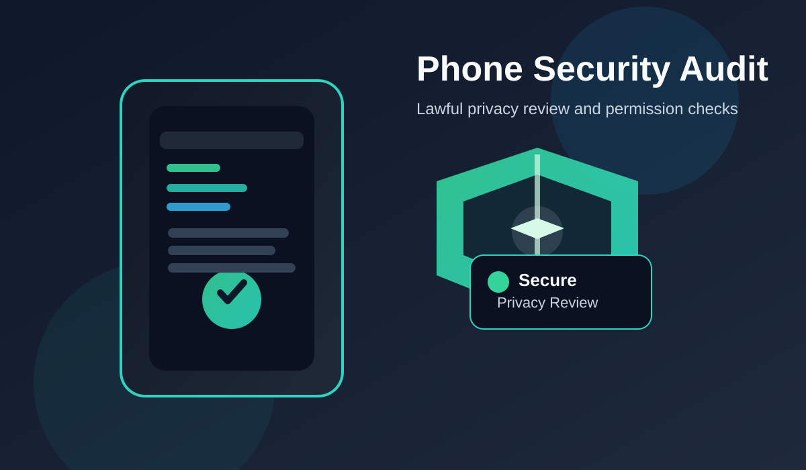

# phone-security-audit

Lawful mobile privacy and permission audit toolkit for authorized device assessment and self-check workflows.



## Overview
This project helps review privacy-related app permissions and document risky settings in a lawful, self-audit workflow.

## Features
- device metadata check
- permission review
- privacy findings summary
- JSON report export

## Run locally

```bash
python -m venv .venv
source .venv/bin/activate
python phone_security_audit.py
```

## Important
Use only on your own device or on devices you are explicitly authorized to assess.
